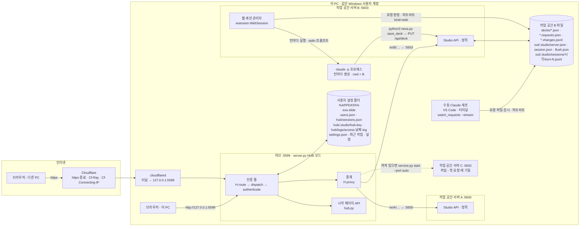
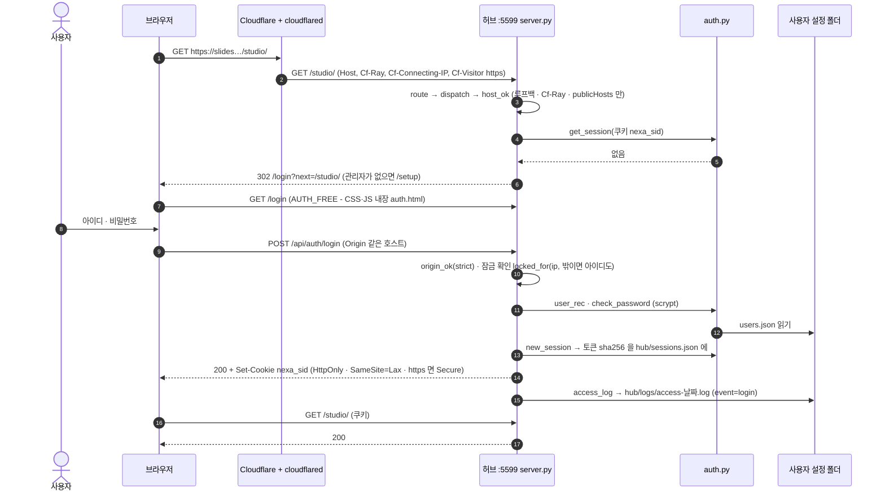
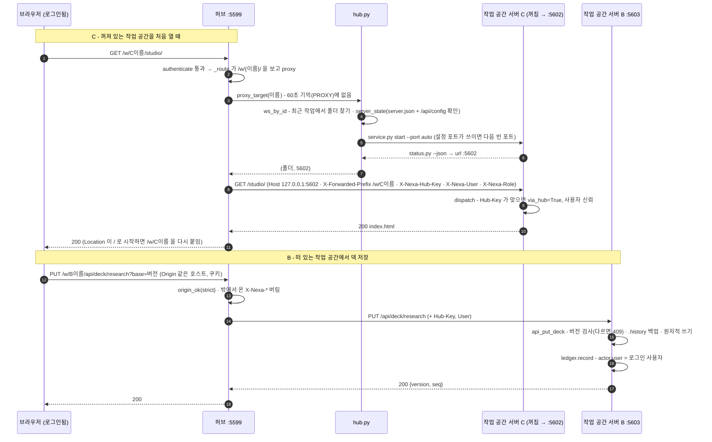
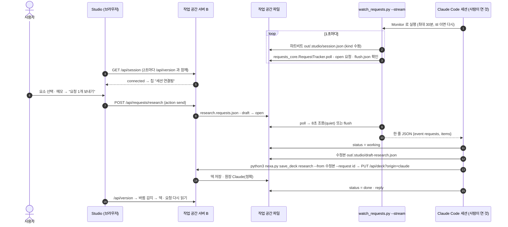
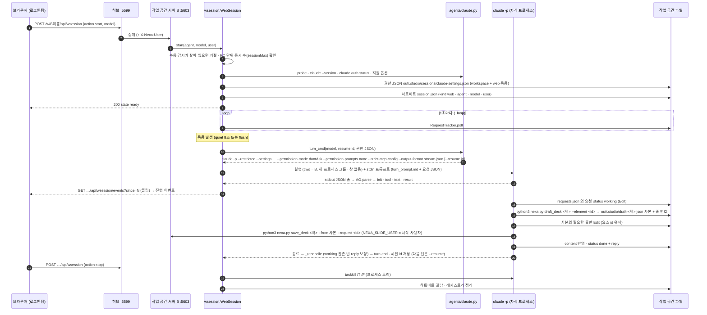
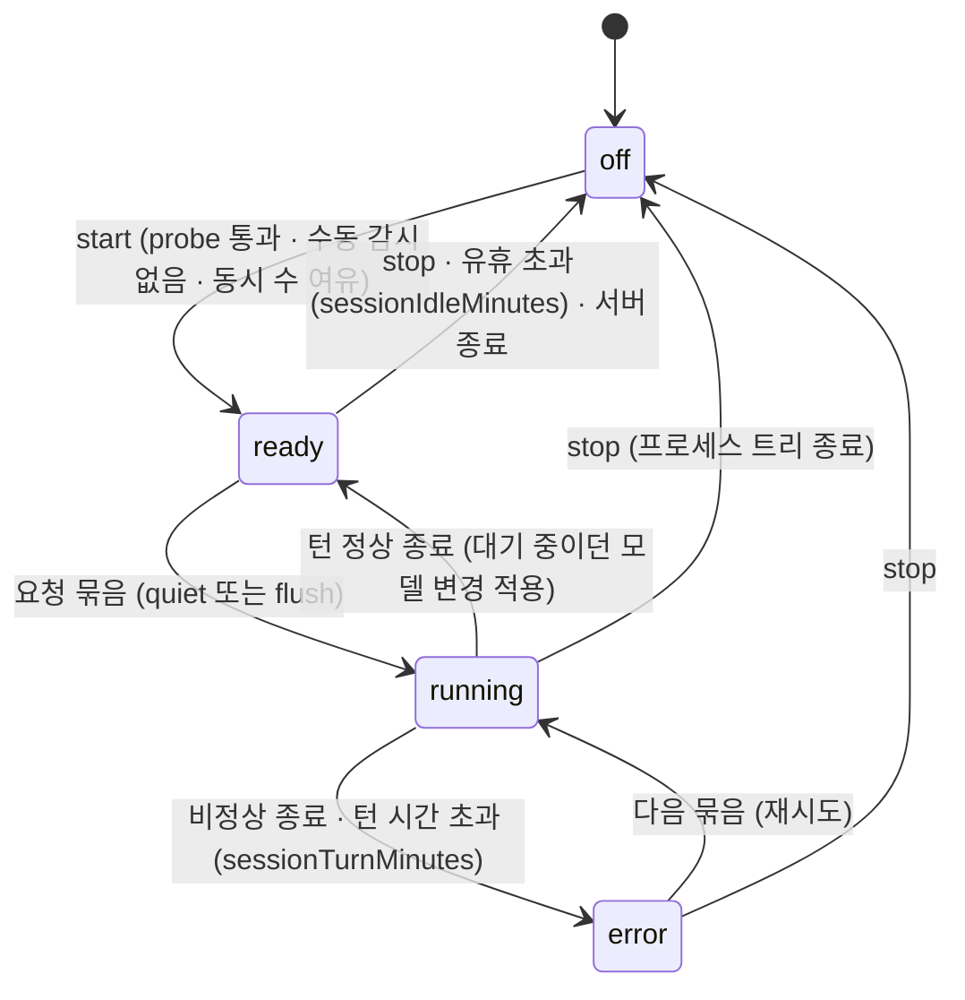

# 동작 메커니즘 — 허브 · 중계 · 인증 · AI 세션

허브 한 포트(5599)로 여러 작업 공간을 웹에 내놓고, 로그인한 사용자가 Studio 에서 고치거나 AI 세션에 요청할 때 **어느 프로세스가 무엇을 하고, 어느 소스의 어느 함수가 그 일을 하는지**를 그림으로 정리한다.
규칙의 자세한 설명은 각 문서([server.md](server.md) · [auth.md](auth.md) · [claude-session.md](claude-session.md) · [change-ledger.md](change-ledger.md) · [dev/web-session-design.md](dev/web-session-design.md)), 운영 절차는 [server-admin.md](server-admin.md).

> 그림 형식: **구성은 flowchart**(무엇이 어디에 있나), **시간 순서는 sequence diagram**(요청이 어떻게 흐르나), **세션 수명은 state diagram**(상태가 어떻게 바뀌나)으로 나눴다.
> 한 그림에 다 넣으면 읽기 어렵다 — 구성도로 위치를 잡고, 궁금한 흐름의 시퀀스 그림을 본다.
> 소스 위치는 이 문서를 쓴 시점(B-3, `717af8a`)의 함수 이름 기준이다. 줄 번호는 바뀌므로 함수 이름으로 찾는다.

## 0. 예시 구성 — 작업 공간 3개

이 문서는 허브에 등록된(최근 작업) 작업 공간 3개를 예로 든다. 세 곳은 만들어진 방식이 서로 달라 각 경우를 보여 준다.

| | 작업 공간 | 폴더 형태 | 설정 포트 | 상태(예) | 보여 주는 경우 |
|---|---|---|---|---|---|
| A | 교재 | 기존 저장소 안 `ppt/`(작업 공간 폴더 이름을 바꿈 — `--slides-dir ppt`) | 5600 | 실행 중 | 저장소형 · 폴더 이름 변경 |
| B | 강의 | 기준 폴더 아래 `<제목>/slides/`(기본) | 5603 | 실행 중 · 웹 세션 시험 | 기본 저장소형 · 웹 AI 세션 |
| C | 사용자 매뉴얼 | 기준 폴더 아래, **경로에 `&`** | 5602 | 꺼짐 | 첫 요청 때 허브가 띄움 · pyenv-win 의 `&` 주의 |

중계 이름은 `폴더 이름(슬러그) + 경로 해시 6자`다(`hub.ws_id`) — 예: `/w/강의--1-slides-fbcae1/`. 같은 이름의 폴더가 여러 곳에 있어도 해시로 갈린다.

## 1. 구성도

| 프로세스 | 소스 | 띄우는 방법 | 하는 일 |
|---|---|---|---|
| cloudflared | (외부 프로그램) | Windows 서비스 | `slides.<도메인>` → `127.0.0.1:5599` |
| 허브 :5599 | `studio/server.py`(작업 공간 없이 → `HUB=True`) + `hub.py` · `auth.py` | `python3 studio/service.py start`(작업 공간 밖) | 로그인 · 시작 페이지 · 중계 · 접근 로그 |
| 작업 공간 서버 :56xx | `studio/server.py`(작업 공간 모드) | `nexa.py start` 또는 허브가 `service.py start --port auto` | Studio 정적·API · 덱 저장 · 원장 · 웹 세션 |
| 웹 세션 턴 | `claude -p …`(`agents/claude.py` 가 명령 구성) | 작업 공간 서버의 `wsession` 이 턴마다 | 요청 묶음 처리 → `save_deck` |
| 수동 세션 | Claude Code + `watch_requests.py` | 사람이 연 세션이 Monitor 로 | 같은 규약으로 요청 처리 |

## 2. 로그인 — 허브는 로컬이어도 로그인 필수

| 단계 | 소스 · 함수 |
|---|---|
| 요청 바깥 틀(Host → 로그인 → CSRF → 라우팅 → 로그) | `server.py` `H.route` · `H.dispatch` · `H.authenticate` · `H.deny_login` · `H.host_ok` · `H.origin_ok` · `H.access_log` |
| 로그인 · 설정 · 계정 API | `server.py` `H.api_post_auth` · `H.api_get_auth` |
| 계정 · 세션 · 잠금 · 쿠키 · 공유 비밀 · 로그 파일 | `auth.py` `hash_password`·`check_password`·`add_user`·`new_session`·`get_session`·`locked_for`·`cookie_header`·`hub_key`·`log_access` |
| 로그인 · 계정 화면 | `studio/auth.html` · `studio/account.html` |
| 터미널 관리(초기화 등) | `python3 studio/auth.py list\|add\|reset-password\|role\|delete` |

## 3. 중계 — `/w/{이름}/…` 가 작업 공간 서버로 가는 길

허브가 **역방향 프록시**로 동작한다. 작업 공간 서버는 따로 "프록시 모드"가 있지 않고 평소대로 응답한다.
허브가 경로 접두를 떼고, 헤더를 갈아 끼우고, 응답의 `Location` 에 접두를 다시 붙인다.

| 단계 | 소스 · 함수 |
|---|---|
| 중계 판단 · 전달 · 응답 헤더 처리 | `server.py` `H._route`(경로가 `/w/` 로 시작) · `H.proxy` · `HOP_HEADERS` |
| 대상 찾기 · 기억 | `server.py` `proxy_target`(60초 캐시 `PROXY`) → `hub.py` `proxy_target` · `ws_by_id` · `server_state` · `_serving` |
| 꺼진 서버 띄우기 | `hub.py` `start_server` → `service.py start --port auto` → `status.py --json` |
| 중계 이름 | `hub.py` `ws_id`(슬러그 + 경로 sha 6자) · 최근 작업 = `settings.json` 의 `recent` |
| 편집기가 접두를 붙이는 곳 | `studio.js`(주소의 `/w/{id}` → `/api`·`/out`·그림 앞) · `menu.js`(이 작업 공간 링크에만) · `slide.html` |
| 작업 공간 서버의 신뢰 판정 | `server.py` `H.dispatch`(`X-Nexa-Hub-Key` == `auth.hub_key()` 일 때만 `X-Nexa-User` 사용, 틀리면 403) |
| 덱 저장 · 원장 | `server.py` `H.api_put_deck` · `ledger.py` `record` · `append` |

## 4. 편집기 요청 → 수동 Claude 세션

사람이 VS Code·터미널에서 연 Claude Code 세션이 감시를 거는 방식(지금 주로 쓰는 방식).

| 단계 | 소스 · 함수 |
|---|---|
| 감시 · 묶음 판정 · 하트비트 | `watch_requests.py` `main` → `requests_core.py` `RequestTracker.poll` · `heartbeat` · `session_status` · `open_requests` |
| 요청 파일 API | `server.py` `H.api_post_requests`(add · send · update · delete · discard) |
| 연결 표시 | `server.py` `H.api_get_session` · `studio.js` 세션 칩 |
| 저장 | `save_deck.py` `via_server`(서버가 떠 있으면 PUT) · `direct`(없으면 원자적 쓰기 + 원장) |
| 세션 활동 표시(수동 세션만) | 작업 공간 `.claude/settings.json` hooks → `nexa.py session_hook` → `session_hook.py` |
| 권한(수동 세션) | `studio/agents/permissions.json` 의 `workspace` 묶음을 `init_workspace.ensure_claude_settings` · `update_launcher` 가 합침 |

## 5. 웹 AI 세션 — 서버가 Claude 를 띄운다 (B-3)

| 단계 | 소스 · 함수 |
|---|---|
| 세션 API | `server.py` `H.api_get_wsession` · `H.api_post_wsession`(start · stop · model · defaults) · `H.api_get_agent` |
| 상태 기계 · 턴 · 수명 | `wsession.py` `WebSession.start` · `_loop` · `_turn` · `_prompt` · `_reconcile`(처리 못 한 요청 보정) · `set_model` · `stop` · `_kill` · `live_sessions`(PC 단위 동시 수) |
| 세션이 쓰는 명령 | `draft_deck.py`(덱 사본 + 줄 번호) · `save_deck.py` · `help.py`(명령 목록) · `layout_samples.py` · `slide_types.py` — 모두 `python3 nexa.py <명령>` 으로만 |
| 에이전트 어댑터 | `agents/base.py` `Agent`(probe · turn_cmd · parse · env) · `agents/claude.py` · `agents/codex.py`(미확인) · `agents/__init__.py` `effective`(설정 우선순위) · `web_settings` |
| 권한 · 프롬프트 | `agents/permissions.json`(workspace · web 묶음) · `wsession._web_settings`(이 작업 공간 `nexa.py` 절대 경로 형태 추가) · `agents/turn_prompt.md` |
| 사용자 기록 | `save_deck.py` `via_server`(`NEXA_SLIDE_USER` → `X-Nexa-Session-User`) → 원장 `actor.user` |
| 기록 | `out/.studio/sessions/{시작 시각}/turn-N.jsonl`(출력 원문) · `session.log`(이벤트) · 접근 로그 `event=session.*` |

## 6. 상태 파일 — 어디에 무엇이 있나

| 위치 | 파일 | 쓰는 곳 | 읽는 곳 |
|---|---|---|---|
| 사용자 설정 폴더 | `settings.json`(최근 작업 · 기준 폴더 · 허브 설정) | `hub.py` | 허브 · `paths.py` |
| | `users.json` · `hub/sessions.json` | `auth.py` | 허브 |
| | `hub/.studio/hub-key` | `auth.hub_key`(처음 한 번) | 허브 · 작업 공간 서버 |
| | `hub/logs/access-YYYY-MM-DD.log` | 허브 · 작업 공간 서버 `access_log` | 운영자 |
| | `hub/.studio/wsessions/*.json` | `wsession`(살아 있는 웹 세션) | 다른 작업 공간의 `wsession`(동시 수) |
| 작업 공간 | `decks/{덱}.json` · `.history/` | 작업 공간 서버 · `save_deck` | Studio · AI 세션 |
| | `decks/{덱}.requests.json` | Studio(서버 API) · AI 세션 | 감시(`requests_core`) |
| | `decks/{덱}.changes.jsonl` | `ledger.py` | Studio 변경 탭 |
| | `out/.studio/server.json` | 작업 공간 서버 | 허브 · `nexa.py status` |
| | `out/.studio/session.json`(하트비트) · `flush.json`(지금 보내기) | 감시 · `wsession` / Studio | Studio 칩 · 감시 |
| | `out/.studio/sessions/…` · `wsession.json` | `wsession` | 진행 패널 · 운영자 |

## 7. 알려진 한계 (B-3 시험, 2026-10-14)

- ~~웹 세션이 요청을 처리하려면 덱 전체를 새 파일로 다시 써야 한다~~ → 고침: `python3 nexa.py draft_deck <덱> --element <id>` 가 사본(`out/.studio/draft-<덱>.json`)과 고칠 줄 번호를 주고, 세션은 사본의 필요한 줄만 Edit 한 뒤 `save_deck --from` 으로 저장한다(`studio/draft_deck.py`, `agents/turn_prompt.md`). `python3 nexa.py help` 로 명령 목록.
- ~~처리하지 못한 요청이 답변 없이 "대기"로 남는다~~ → 고침: 턴이 끝나면 서버가 묶음의 요청을 대조해(`wsession._reconcile`) `working` 잔존은 `open` 으로 되돌리고, 빈 reply 에는 "세션이 처리하지 못했습니다: <사유>" 를 적는다. `warn` 이벤트.
- ~~접근 로그 줄 섞임~~ → 고침: 잠금 파일(`hub/logs/access.lock`)로 쓰기를 직렬화한다(`auth._log_lock`).
- 진행 표시는 아직 폴링이다(SSE·화면은 B-4·B-5).
- 엔진 문서(`docs/`)는 작업 공간 밖이라 웹 세션이 읽지 못한다 — 규칙은 턴 프롬프트와 안내 파일에, 구조 정보는 `nexa.py layout_samples`·`slide_types` 명령으로 준다.
